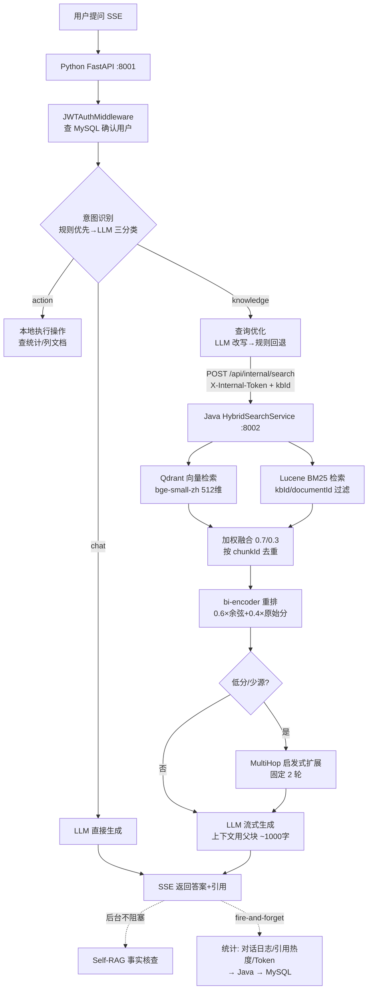
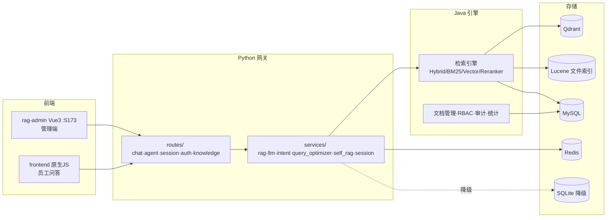

# 项目上下文包（Project Context Pack）

> 用途：一次性喂给 AI 的项目上下文。生成日期：2026-10-24。

---

## 1. 一句话定位

这是一个基于 **FastAPI (Python) + Spring Boot (Java) + Vue 3** 三层架构的**企业知识库 RAG 客服助手**：员工用自然语言提问，系统经「意图路由 → 查询改写 → 混合检索（Qdrant 向量 + Lucene BM25）→ bi-encoder 重排 → 父文档扩展 → LLM 流式生成 → Self-RAG 事实核查」生成有引用的回答；Python 层负责 LLM 编排与对话管理，Java 层负责文档解析/索引/检索/权限/统计，另有一条 DeepSeek Function Calling 驱动的 Agent 模式链路。

---

## 2. 架构总览

### 模块划分

| 模块 | 技术 | 职责 |
|------|------|------|
| AI 网关 `backend/` | Python FastAPI (:8001) | 意图识别、查询改写、会话管理、LLM 流式生成、Self-RAG、Agent 模式、JWT 校验 |
| 检索引擎 `rag-engine/` | Spring Boot 3.4.4 + MyBatis-Plus (:8002) | 文档上传/解析/切片/索引、Qdrant + Lucene BM25 混合检索、重排、多跳、RBAC、统计审计 |
| 管理前端 `rag-admin/` | Vue 3 + Element Plus + Pinia + ECharts (:5173) | 知识库/文档/切片管理、对话记录、仪表盘、安全配置 |
| 简易对话前端 `frontend/` | 原生 HTML/JS | 员工问答入口（单页，SSE） |

### 核心数据流（Mermaid）





### 外部依赖

- **DeepSeek API**（任何 OpenAI 兼容端点可替换，只改 `.env` 三行）：LLM 生成、意图分类、查询改写、Self-RAG 验证
- **Qdrant** (:6334 gRPC)：child 集合 `rag_knowledge` + parent 集合 `rag_knowledge_parent`
- **Embedding**：bge-small-zh-v1.5，ONNX 本地 CPU 推理，512 维（索引与检索、bi-encoder 重排共用）
- **Lucene 9.12**：本地 BM25 文件索引（`data/bm25_index/`），支持 kbId/documentId 过滤
- **MySQL 8** (`rag_engine` 库)：用户/知识库/文档/切片/对话日志/审计/权限（26 张表）
- **Redis 7**：会话状态 + 消息历史缓存；不可用时降级 SQLite（`data/rag_assistant.db`）

### 关键约定

- Python → Java 只通过 `POST /api/internal/search` 等内部接口通信，需带 `X-Internal-Token` 头（fail closed：未配置 INTERNAL_API_TOKEN 时 Java 启动失败）
- JWT 密钥两侧必须一致（`JWT_SECRET`），HS256；Python 侧校验签名后查 MySQL 确认用户存在
- 检索结果统一字段：`content / filename / page / score / doc_id / chunk_id / chunk_index / parent_chunk_id / kb_id`
- **异常处理**：全局 exception_handler 统一返回 `{success: false, error, type, status_code}`（HTTPException→status、RequestValidationError→422、ValueError→400），路由内不再各自拼错误格式
- **中间件顺序**：后添加的更靠外层先执行——`JWTAuthMiddleware`（外）→ `LicenseMiddleware`（内），未登录先被 401 拦下，不向匿名者泄露授权状态

---

## 3. 核心设计（精简版）

### 核心目标

企业内部员工的制度/流程/操作类问答，答案带文档引用；私有化可部署（LLM 可换内网 vLLM/Ollama）。

### 非目标（边界）

- 不做跨企业多租户 SaaS；不做通用爬虫搜索引擎；不做模型训练/微调
- 不追求 Cross-Encoder 级重排精度（当前 bi-encoder 二次打分够用）

### 核心算法/方案

- **父子文档分块**：child ~300 字（overlap 50）做精确检索，payload 存 `parentContent`（~1000 字，overlap 100），LLM 上下文用父块 —— 小块检索、大块生成
- **混合检索**：向量 0.7 + BM25 0.3 加权融合，按 chunkId 去重；KB 级可覆盖权重（`searchWithKbConfig`）
- **意图路由**：规则快配先行（零成本），未命中再 LLM 三分类（chat/knowledge/action）
- **Agent 模式**：`/api/agent/chat`，DeepSeek Function Calling，工具注册表驱动，最多 5 轮迭代
- **语义缓存**：相似度阈值 0.92，TTL 86400s，可开关
- **Token 估算**：CJK-aware（中文 ~1.5 token/字，非中文 ~0.25 token/字），不用字符数÷4

### 已知缺陷 / 待优化方向（详见 docs/capability-audit.md）

- 文档解析是请求内同步执行：`ParseTaskService` 状态机存在但零调用，线程池 Bean 零注入 —— 异步化是下一步
- Reranker 是 bi-encoder 而非 Cross-Encoder；MultiHop 是启发式而非 LLM 生成补充查询
- 安全模块曾大面积"仅配置未接线"（限流/访问控制/API Key/敏感词），2026-10-19 审计后部分已修复，`SecurityController` 链路需复核
- ~~评测缺 ground truth：暂无 MRR/NDCG/HitRate~~ → 已重建 `test_rag.py`（直连 Java 检索，MRR/NDCG@10/HitRate@3，报告写 `evaluation/retrieval_report.md`），相关性用 expected_keywords 命中比例做代理，人工标注仍待补

### 重要取舍

- **Qdrant 而非 Chroma**：gRPC 高性能 + payload 过滤；Chroma 仅作为无 Java 引擎时的本地降级路径（可选依赖，默认不装进镜像）
- **Python+Java 双后端**：Python 管 LLM 编排（生态好），Java 管检索引擎和业务数据（ORM/RBAC 成熟）
- **Lucene BM25 而非 ES**：本地文件索引、无外部服务、支持权限过滤字段
- **bi-encoder 重排**：复用 Embedding 模型，零额外推理开销

---

## 4. 目录结构 + 关键文件清单

```
D:/RAG-study/
├── backend/                    # Python AI 网关（:8001）
│   ├── main.py                 # 入口：lifespan 初始化 MySQL/Redis/Docling，挂中间件+路由
│   ├── config.py               # 全部配置项（.env 读取、分块/检索/LLM/缓存阈值）
│   ├── models/schemas.py       # Pydantic 入参出参（ChatRequest/GuestChatRequest/...）
│   ├── routes/chat.py          # 主问答链路 /api/chat（SSE 流式）+ 访客/统计/缓存接口
│   ├── routes/agent.py         # Agent 模式路由
│   ├── agent/                  # Agent 框架：core.py（循环）、tool_registry.py（工具注册）、tools/（web_search、file_parser、api_integration、code_interpreter、image_tools）
│   ├── services/
│   │   ├── rag_service.py      # 检索编排：_java_search() → Java；_local_search() Chroma 降级
│   │   ├── llm_service.py      # OpenAI 兼容调用 + SSE 流式
│   │   ├── intent_service.py   # 意图三分类（规则→LLM）
│   │   ├── query_optimizer.py  # 查询改写（LLM→规则回退）
│   │   ├── self_rag_service.py # 事实核查
│   │   ├── session_service.py  # Redis 会话 + SQLite 降级
│   │   └── semantic_cache.py / docling_service.py / agent_service.py / ...
│   ├── middleware/             # auth_middleware.py (JWT)、license_middleware.py、rate_limit_middleware.py (对话限流, Redis 滑动窗口)
│   ├── database/db.py          # SQLite + Redis + MySQL 连接池
│   └── test_full.py / test_rag.py / test_security_fixes.py / test_kb_filter.py  # 集成测试 + 检索评测(MRR/NDCG) + 离线安全回归 + kbId 过滤冒烟
├── rag-engine/                 # Java 检索引擎（:8002）
│   └── src/main/java/com/ragstudy/
│       ├── controller/SearchController.java    # /api/internal/search（Python 调用入口）
│       ├── controller/InternalSecurityController.java  # /api/internal/security/sensitive-check（敏感词检查）
│       ├── service/HybridSearchService.java    # 向量+BM25 CompletableFuture 并行融合
│       ├── service/VectorStoreServiceImpl.java # Qdrant gRPC（提取 parentContent；kbId 双类型过滤）
│       ├── service/Bm25ServiceImpl.java        # Lucene BM25（kbId/documentId 过滤）
│       ├── service/RerankerService.java        # bi-encoder 二次打分
│       ├── service/KnowledgeSearchService.java # 检索门面 + KB 级配置
│       ├── service/KnowledgeBaseService.java   # 文档索引/删除/级联清理
│       ├── service/DocumentProcessService.java # 文档处理管线（@Async parseTaskExecutor + ParseTask 进度）
│       └── security/                            # SecurityCheckFilter(限流/访问控制/API Key)、JWT Filter、InternalApiAuthFilter
├── rag-admin/                  # Vue 3 管理前端（views/: kb/document/chunk/conversation/dashboard/security/audit/apikey/debug/system/login）
├── frontend/                   # 原生 JS 员工问答页
├── docs/                       # architecture.md、capability-audit.md（接线审计）、requirements.md
├── docker-compose.yml          # mysql/redis/qdrant/rag-engine/backend/frontend 六服务
├── .env.example                # 全部环境变量说明（.env 是唯一事实源）
└── deploy/nginx/rag-assistant.conf
```

---

## 5. 核心代码片段

### 入口启动（backend/main.py，节选）

```python
@asynccontextmanager
async def lifespan(app):
    await init_db()                                  # SQLite
    await init_mysql()                               # MySQL 连接池（失败仅告警，登录不可用）
    await get_redis()                                # 失败降级 SQLite 会话
    threading.Thread(target=docling_service.init_background, daemon=True).start()  # 解析器后台预热
    yield
    await close_redis(); await close_mysql_pool()

app.add_middleware(LicenseMiddleware)     # 内层：JWT 之后再验 license
app.add_middleware(JWTAuthMiddleware)     # 外层：先执行，未登录 401
# 全局异常 handler 统一输出 {success, error, type, status_code}
```

### Python → Java 检索调用（backend/services/rag_service.py:58）

```python
async def _java_search(self, query, top_k, use_hybrid, threshold, kb_id=None):
    filters = {"kbId": str(kb_id)} if kb_id else {}
    async with httpx.AsyncClient(timeout=JAVA_TIMEOUT) as client:
        resp = await client.post(
            f"{JAVA_BACKEND_URL}/api/internal/search",
            headers=internal_headers(),          # X-Internal-Token
            json={"query": query, "topK": top_k,
                  "enableHybrid": use_hybrid, "filters": filters,
                  **({"kbId": int(kb_id)} if kb_id else {})})
    # 统一输出字段；低于阈值丢弃；优先父块内容做 LLM 上下文
    sources.append({
        "content": parent_content or r["content"],
        "filename": doc_name, "page": chunk_index, "score": round(score, 4),
        "doc_id": doc_id, "chunk_id": chunk_id, "chunk_index": chunk_index,
        "parent_chunk_id": parent_chunk_id, "kb_id": metadata.get("kbId", ""),
    })
```

### Java 混合检索（rag-engine/.../HybridSearchService.java）

```java
public List<SearchResultVO> hybridSearch(String query, int topK,
        Map<String,String> filters, double vectorWeight, double bm25Weight) {
    CompletableFuture<List<SearchResultVO>> vectorFuture =
        CompletableFuture.supplyAsync(() -> vectorStoreService.search(query, topK, filters));
    CompletableFuture<List<SearchResultVO>> bm25Future =
        CompletableFuture.supplyAsync(() -> bm25Service.search(query, topK, filters));
    List<SearchResultVO> merged =
        mergeResults(vectorFuture.join(), bm25Future.join(), vectorWeight, bm25Weight);
    // mergeResults: 同 chunkId 累加加权分去重，按综合分排序
}
```

### Agent 调度循环（backend/agent/core.py，Function Calling 主循环节选）

```python
class AgentService:
    async def run(self, query, history=None, session_id="") -> AsyncGenerator[dict, None]:
        messages = self._build_messages(query, history)
        tools = tool_registry.get_all_schemas()          # 工具注册表驱动
        while iteration < self.max_iterations:           # AGENT_MAX_ITERATIONS=5
            result = await self.client.chat_completion_with_tools(
                messages=messages, tools=tools, tool_choice="auto", ...)
            if result["finish_reason"] == "tool_calls":
                for tc in result["tool_calls"]:
                    yield {"type": "tool_call", "tool_name": ..., "arguments": ...}
                    tool_result = await tool_registry.execute(tool_name, arguments)
                    yield {"type": "tool_result", "result": tool_result[:800]}
                    if tool_name in ("web_search", "search_knowledge"):
                        all_sources.append(...)          # 收集引用来源
            else:
                yield {"type": "answer", "content": result["content"]}; return
```

工具清单（`agent/tool_registry.py` 注册，`agent/tools/` 实现）：`search_knowledge`、`file_list/file_read`、`web_search`、`code_execute`、`http_request`（受 `HTTP_TOOL_ALLOWED_HOSTS` 白名单 + 禁内网 SSRF 控制）、`image_generate/image_analyze`、`get_session_history`。一次回复工具调用不超过 3 个。

### 向量库写入/查询（rag-engine/.../VectorStoreServiceImpl.java，Qdrant gRPC）

```java
public void upsertBatch(String collectionName, List<VectorEntry> entries) {
    // 包装 PointStruct（id + vector + payload：content/parentContent/chunkIndex/
    // documentId/kbId/docName）→ client.upsertAsync(collectionName, points).get()
}
public List<SearchResultVO> search(String collectionName, float[] queryVector, ...) {
    // 向量相似度检索 + filter 透传（kbId 精确匹配）
    // 从 payload 提取 parentContent/chunkId/parentChunkId → SearchResultVO
}
public void ensureCollection(String collectionName, int vectorSize);  // 512 维
public void deleteById(String collectionName, String id);
```

集合：`rag_knowledge`（child，~300字）+ `rag_knowledge_parent`（parent，~1000字）；child payload 冗余存 `parentContent`，检索命中子块直接取父块做 LLM 上下文。

### 数据结构（backend/models/schemas.py）

```python
class ChatRequest(BaseModel):
    session_id: str
    message: str
    kb_id: Optional[str] = None      # 检索权限过滤用

class GuestChatRequest(BaseModel):
    message: str
```

### 主链路入口（backend/routes/chat.py）

- `chat(request, raw_request, current_user)` (:170) → 内部 `generate()` SSE 流式；辅助：`_save_conversation`、`_verify_and_log`（Self-RAG 后台）、`_record_stats`（fire-and-forget 统计）、`_estimate_tokens`（CJK-aware）
- 另有 `/api/chat/guest`（访客）、`/api/chat/test-stream`、语义缓存 stats/clear

---

## 6. 运行 & 调试

### 启动

```bash
cp .env.example .env        # 填 MYSQL/JWT_SECRET/INTERNAL_API_TOKEN/LLM_API_KEY
docker compose up -d        # 六服务：mysql/redis/qdrant/rag-engine(:8002)/backend(:8001)/frontend(:80)
```

本地开发可用 `start-all-local.bat` / `start-apps.bat`（Windows）。Python 单独跑：`cd backend && uvicorn main:app --port 8001`。

### 环境变量要点（详见 .env.example）

- `JWT_SECRET`：≥32 字符，Python/Java 必须一致（config.py 启动时强校验，缺了直接 RuntimeError）
- `INTERNAL_API_TOKEN`：`/api/internal/**` 门禁，Java fail closed
- `LLM_BASE_URL / LLM_API_KEY / LLM_MODEL`：OpenAI 兼容端点，换模型只改这三行；换后跑 `python deploy/check-llm.py` 能力探测，工具调用不可用则设 `ENABLE_AGENT_MODE=false`
- `VECTOR_WEIGHT=0.7 / BM25_WEIGHT=0.3 / TOP_K=5 / SIMILARITY_THRESHOLD=0.3`
- `INSTALL_FALLBACK=false`：默认不把 Chroma 降级依赖装进镜像（省 ~900MB）
- `CORS_ALLOW_ORIGINS`：逗号分隔，禁用 `*`
- `GUEST_KB_IDS`：访客可检索的知识库白名单（逗号分隔）；空 = 访客不检索、退化为闲聊（fail closed）
- `RATE_LIMIT_ENABLED / RATE_LIMIT_USER_PER_MIN(20) / RATE_LIMIT_GUEST_PER_MIN(5)`：对话链路限流
- `ENABLE_SENSITIVE_WORD_CHECK`：检索前敏感词检查开关（Java 不可达时 fail open）
- `SELF_RAG_MODE`：off / log / corrective（默认 corrective，不充分时同步补检索重生成）

### 测试 / 复现

```bash
python backend/test_full.py         # 集成用例（含越权访问 404 回归）
python backend/test_rag.py          # 检索评测：MRR/NDCG@10/HitRate@3（需 rag-engine 在线）
python backend/test_security_fixes.py  # 离线安全回归（stub Redis，无需起服务）
python backend/test_kb_filter.py    # kbId 过滤冒烟（需 rag-engine 在线）
curl -X POST :8001/api/health       # 健康检查（Redis/Java 连通性）
```

最小检索复现：注册登录拿 token → `POST /api/chat {"session_id":"t1","message":"报销流程是什么","kb_id":"1"}` → 观察 SSE 流与 sources。

### 常见坑

1. Embedding 首次加载慢 → HF 国内镜像 `HF_ENDPOINT=hf-mirror.com`，lifespan 已预加载
2. BM25 与向量库不一致 → 上传后同步写 Lucene；索引损坏可开 `rag.bm25.auto-rebuild=true`
3. Redis 挂了 → 自动降级 SQLite，会话功能不中断但登录依赖 MySQL
4. JWT 密钥两侧不一致 → Java 签发的 token 在 Python 侧 401
5. 排查日志：`logs/`、根目录 `backend_debug*.log`

---

## 7. 约束清单（写代码前必读）

1. **新增接口统一 Pydantic 校验**（`models/schemas.py` 定义入参出参，禁止裸 dict 入参）
2. **检索必须带权限过滤**：检索调用必须透传 `kb_id`，Qdrant filter 与 BM25 filter 两条路都要支持
3. **Python↔Java 内部接口必须带 `X-Internal-Token`**；新增内部接口放 `/api/internal/**`
4. **引用字段统一**：检索结果一律输出 `doc_id/chunk_id/chunk_index/kb_id`，不要另起字段名
5. **不引入新的大依赖**（尤其 Python 侧 torch 类）；降级依赖只进 `requirements-fallback.txt`
6. **LLM 调用统一走 `llm_service` + `utils/http_client.py`**，不得散落直接 `import openai`
7. **配置一律进 `config.py` 读环境变量**，代码里不写死密钥/URL；变量命名优先 `LLM_*`（兼容旧 `DEEPSEEK_*`）
8. **日志统一 `[模块] 消息` 格式**（如 `[BM25]`、`[RAG]`），print 输出
9. **前端组件基于 Element Plus**（rag-admin），员工问答页 `frontend/` 保持原生 JS
10. **改 Java 检索/删除逻辑时同步维护父块集合**（`rag_knowledge_parent`），删除必须级联清理 Qdrant + BM25 + DB
11. **统计上报 fire-and-forget**，不阻塞主响应链路
12. **改动检索行为后跑 `test_rag.py` + `test_full.py`**，并更新 `docs/capability-audit.md` 的接线状态
13. **文档上传是异步的**：上传接口立即返回 PARSING/processing，前端按文档 status 轮询至 READY/indexed/FAILED；新增上传入口必须走 `DocumentProcessService`（勿在请求线程内同步跑切片/向量化管线）
14. **对话入口（chat/guest/agent）自动经过限流中间件**（RATE_LIMIT_*，Redis 滑动窗口）；新增对话类端点需加入 `rate_limit_middleware.py` 的 `RATE_LIMITED_PATHS`
15. **知识库三级可见级别（G20）**：`kb_knowledge_base.visibility` = PUBLIC（含访客）/ EMPLOYEE（登录用户）/ MANAGEMENT（kb_user_access 授权人 + owner + ROLE_ADMIN）。**检索范围永远由服务端解析**（`services/kb_access.py` → Java `/api/internal/knowledge-bases/accessible`，60s TTL），前端传入的 kb_id 仅为范围缩小提示，不作授权依据；新增检索类调用必须走 `retrieve(kb_ids=...)`，KB 文档接口必须过 `assertKbReadable/assertKbWritable`
